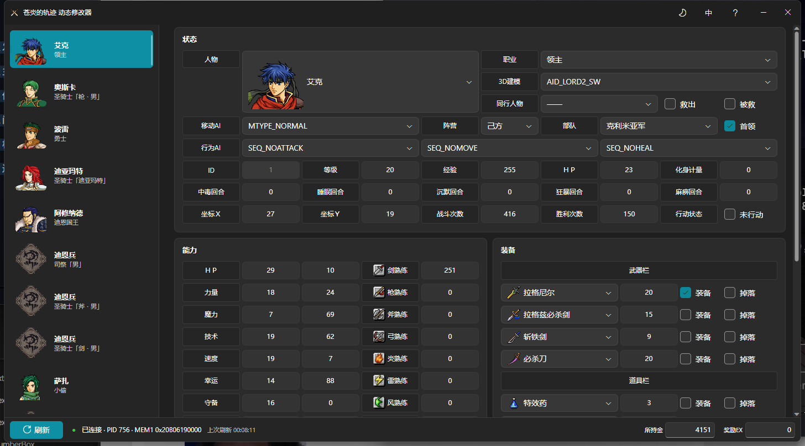

### 苍炎的轨迹 动态修改器

C# / Avalonia 12 / .NET 10 版本，替换了旧的 Python / PySide6 实现。



#### 项目说明

- 修改可能会导致游戏失去乐趣
- 仅支持 Dolphin 5.0 以上版本模拟器，包括稳定版、beta 版及 dev 版等
- 仅支持 64 位 Windows
- 同时支持日文原版及汉化版
- 先打开模拟器开始模拟游戏，再打开修改器，读档进入游戏后点击刷新获取数据
- 修改前和过程中多存档，以免出现不可挽回的损失
- 内置日文和中文两套游戏名词翻译，UI 固定为中文
- 修改完成人物或职业后建议先存档读档一次再进行操作，以防出错
- 将人物改为上级职业时，记得在技能的隐藏特性里勾选“上级职业”
- 可更改人物归属阵营以操作敌方，过关后可能加入，但容易影响后续关卡的强制出击
- 可锁定人物行动状态，重复点击勾选可取消锁定

#### 可修改项目

- [x] 人物
- [x] 能力
- [x] 特技
- [x] 道具
- [x] 支援
- [x] 金钱

#### 运行

环境要求：

- Windows 10/11 x64
- .NET 10 SDK（构建）
- Dolphin 5.0 以上

```bash
dotnet run --project src/PoR.App/PoR.App.csproj
```

也可以使用根目录的 `PoR.sln` 在 Visual Studio 中打开并运行。

#### 发布 EXE

在仓库根目录执行：

```bash
# 自包含单文件版本（体积较大，不依赖本机 .NET）
dotnet publish src/PoR.App/PoR.App.csproj -c Release -p:PublishProfile=win-x64-standalone

# 依赖 .NET 10 Desktop Runtime 的单文件版本（体积较小）
dotnet publish src/PoR.App/PoR.App.csproj -c Release -p:PublishProfile=win-x64-framework-dependent
```

输出目录分别为 `publish/win-x64` 和 `publish/win-x64-framework-dependent`。

#### 版本

1.9.8

#### License

MIT
